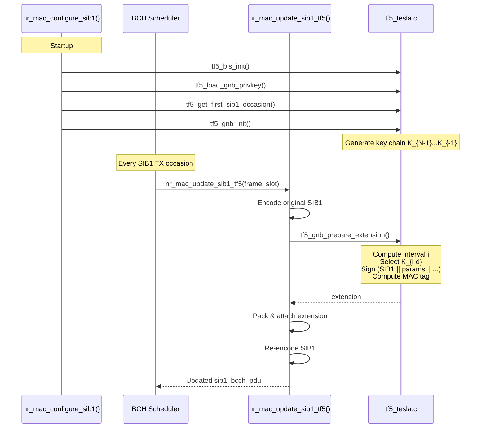

# gNB Implementation

[Back to Index](index.md)

---

## Overview

The gNB (next-generation Node B) is responsible for:

1. **Initialization**: Generate TESLA key chain, load IBS secret key, determine T_0
2. **Per-SIB1 Transmission**: Prepare TESLA extension with current interval's key/signature/tag, attach to SIB1

The gNB signs every SIB1 with both an **IBS signature** (for first-time UE authentication) and a **TESLA MAC tag** (for efficient returning UE authentication).

---

## Source Files

| File | Purpose |
|------|---------|
| `openair2/LAYER2/NR_MAC_gNB/config.c` | TESLA state initialization |
| `openair2/LAYER2/NR_MAC_gNB/nr_radio_config.c` | Per-SIB1 extension update |
| `openair2/LAYER2/NR_MAC_gNB/gNB_scheduler_bch.c` | Scheduler integration |
| `openair3/SECU/tf5_tesla.c` | Core TESLA functions |
| `openair3/SECU/tf5_tesla.h` | Data structures and API |

---

## Initialization Flow

TESLA initialization occurs in `nr_mac_configure_sib1()` ([config.c:1166-1265](../openair2/LAYER2/NR_MAC_gNB/config.c#L1166-L1265)).

### Steps

1. **State Allocation** (line 1177)
   ```c
   cc->tf5_state = calloc(1, sizeof(tf5_gnb_state_t));
   ```

2. **Numerology Configuration** (lines 1181-1182)
   ```c
   int numerology = scc->downlinkConfigCommon->frequencyInfoDL->...->subcarrierSpacing;
   uint16_t slots_per_frame = 10 * (1 << numerology);
   ```

3. **BLS Library Initialization** (line 1200)
   ```c
   rc = tf5_bls_init();
   ```
   Must be called once before any BLS signing operations.

4. **IBS Secret Key Loading** (line 1204)
   ```c
   rc = tf5_load_gnb_privkey(tf5_privkey_file, private_key, &key_validity_end);
   ```
   - Reads 35-byte file: 32B sk_ID + 3B validity_end
   - File issued by Core PKG via `tf5_ibs_issue` tool
   - Validates key hasn't expired

5. **T_0 Calculation** (lines 1229-1230)
   ```c
   tf5_get_first_sib1_occasion(nrmac, &t0_sfn, &t0_slot);
   ```
   - Determines first SIB1 TX occasion from CORESET config
   - Currently supports CORESET mux pattern 1 only (3GPP TS 38.331)

6. **Key Chain Generation** (lines 1242-1248)
   ```c
   rc = tf5_gnb_init(cc->tf5_state,
                     t_int_ms,       // 20ms
                     1,              // d = 1
                     chain_len,      // 65536 by default
                     private_key,
                     &t0,
                     slots_per_frame);
   ```
   Internally generates backward key chain: K_{N-1} (random) → K_0 → K_{-1}

### Configuration Parameters

| Parameter | Value | Source |
|-----------|-------|--------|
| `T_int` | 20 ms | Fixed (aligned with SIB1 repetition) |
| `d` | 1 | Fixed disclosure delay |
| `chain_len` | 65536 | Configurable via `--tf5-chain-len` |
| `slots_per_frame` | 10 × 2^μ | From numerology μ |

---

## Per-SIB1 Extension Update

Before each SIB1 transmission, `nr_mac_update_sib1_tf5()` is called ([nr_radio_config.c:4381-4447](../openair2/LAYER2/NR_MAC_gNB/nr_radio_config.c#L4381-L4447)).

### Steps

1. **Encode Original SIB1** (lines 4392-4403)
   ```c
   // Temporarily remove extension
   OCTET_STRING_t *saved_ext = sib1->lateNonCriticalExtension;
   sib1->lateNonCriticalExtension = NULL;

   // Encode just NR_SIB1 (must match UE-side)
   enc_rval = uper_encode_to_buffer(&asn_DEF_NR_SIB1, NULL, sib1,
                                     cc->sib1_original, sizeof(cc->sib1_original));
   sib1->lateNonCriticalExtension = saved_ext;
   ```
   **Critical**: Must encode `NR_SIB1` (not `NR_BCCH_DL_SCH_Message`) to match UE verification.

2. **Prepare TESLA Extension** (lines 4406-4412)
   ```c
   tf5_extension_t ext;
   rc = tf5_gnb_prepare_extension(cc->tf5_state,
                                  frame, slot,
                                  cc->sib1_original,
                                  cc->sib1_original_length,
                                  &ext);
   ```
   Computes:
   - Current interval index from frame/slot
   - Disclosed key K_{i-d}
   - IBS signature over (SIB1 || params || validity || i || key || timestamp)
   - TESLA MAC tag over (SIB1 || validity)

3. **Pack Extension** (lines 4415-4417)
   ```c
   uint8_t ext_buf[256];
   int ext_len = tf5_pack_extension(&ext, ext_buf, sizeof(ext_buf));
   ```
   Serializes extension to 102-byte binary format.

4. **Attach to SIB1** (lines 4419-4439)
   ```c
   // Allocate/resize lateNonCriticalExtension
   memcpy(sib1->lateNonCriticalExtension->buf, ext_buf, ext_len);
   sib1->lateNonCriticalExtension->size = ext_len;
   ```

5. **Re-encode SIB1** (line 4442)
   ```c
   cc->sib1_bcch_length = encode_SIB_NR(cc->sib1, cc->sib1_bcch_pdu, ...);
   ```
   Final SIB1 with TESLA extension for broadcast.

---

## Scheduler Integration

The BCH scheduler calls the update function before transmission ([gNB_scheduler_bch.c:601-606](../openair2/LAYER2/NR_MAC_gNB/gNB_scheduler_bch.c#L601-L606)):

```c
#ifdef ENABLE_TF5
  if (cc->tf5_state && cc->tf5_state->initialized) {
    nr_mac_update_sib1_tf5(cc, frameP, slotP);
  }
#endif
```

This ensures every SIB1 transmission has a fresh extension with the current interval's signature and tag.

---

## Sequence Diagram



---

## Key Generation Details

The `tf5_gnb_init()` function in [tf5_tesla.c](../openair3/SECU/tf5_tesla.c) generates the key chain:

1. **Random Seed**: Generate random K_{N-1}
2. **Backward Chain**: For i = N-2 down to -1:
   ```
   K_i = F(K_{i+1}) = SHA-256(0x00 || K_{i+1})[0:15]
   ```
3. **Storage**: `key_chain[0]` = K_{-1}, `key_chain[i+1]` = K_i

The chain is stored in forward order for efficient key disclosure during transmission.

---

## Related Documentation

- [Protocol Design](protocol.md) - Key chains, intervals, disclosure delay
- [Cryptography](cryptography.md) - Hash functions, MAC computation
- [Data Structures](data-structures.md) - `tf5_gnb_state_t` structure
- [Build Configuration](build.md) - Key management tools
