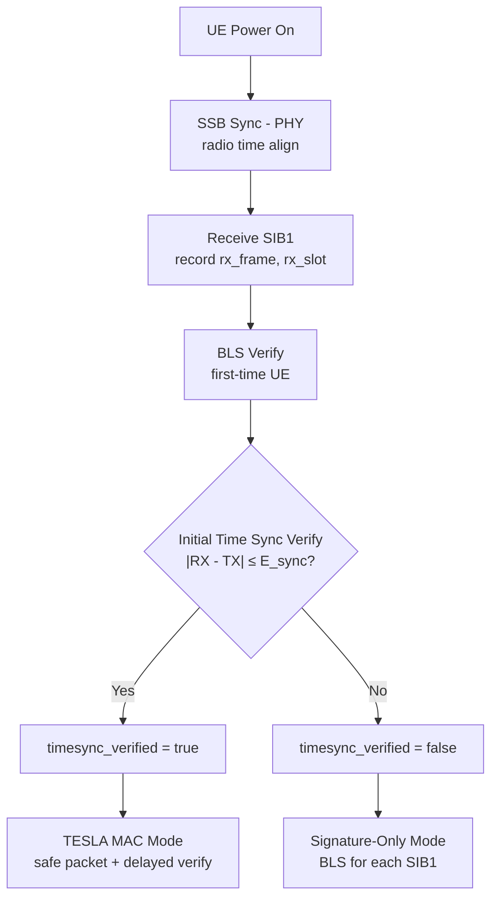

# Time Synchronization for TF5 Bootstrapping

[Back to Index](index.md)

---

This document consolidates the time-synchronization model and the TESLA "safe packet" timing check for TF5.

## References

- **RFC 4082 Section 2.2**: Time synchronization requirements for TESLA
- **3GPP TS 38.101**: UE RF conformance requirements (timing accuracy bounds)
- **3GPP TS 38.133**: UE measurement requirements (synchronization accuracy)

---

## 1. Goal and Context

TESLA requires each receiver to be loosely time-synchronized with the sender in the following sense:

- The receiver must know an **upper bound** on how far its clock can lag behind the sender’s clock, denoted here as $D$ (analogous to TESLA’s $D_t$).

In bootstrapping, we assume **downlink-only** operation prior to authentication (no uplink handshake to compute $D$). Therefore, we rely on **PHY-layer radio-time alignment** (frame/slot timing) and **offline-provisioned bounds** to obtain a conservative $D$ usable in TESLA’s safe-packet test.

---

## 2. Notation

### 2.1 Real (ideal) time

- $\tau \in \mathbb{R}$: ideal “real time” (not directly observable).

### 2.2 Clocks (radio-time clocks)

- Sender (gNB) PHY/radio clock:
  $$C_s : \mathbb{R} \to \mathbb{R},\quad \tau \mapsto C_s(\tau)$$
- Receiver (UE) PHY/radio clock:
  $$C_r : \mathbb{R} \to \mathbb{R},\quad \tau \mapsto C_r(\tau)$$

These are not wall clocks. They represent the radio time axis (frame/slot/symbol timing) each side uses internally.

### 2.3 Same-time clock skew

Define the same-real-time skew:
$$\Delta(\tau) \triangleq C_s(\tau) - C_r(\tau)$$

TESLA’s safe-packet test assumes an upper bound:
$$\forall \tau,\quad \Delta(\tau) \le D$$

Equivalently:
$$C_s(\tau) \le C_r(\tau) + D \quad \text{for all } \tau.$$

### 2.4 Propagation delay (real-time)

For a particular transmission:

- gNB transmits at real time $\tau_{tx}$
- UE receives at real time $\tau_{rx}$

Propagation delay:
$$\tau_{\text{prop}} \triangleq \tau_{rx} - \tau_{tx} > 0$$

Assume an engineering bound:
$$0 \le \tau_{\text{prop}} \le \tau_{\text{prop,max}}.$$

Important: TESLA security does not require knowing $\tau_{\text{prop}}$ at runtime; propagation and processing primarily affect availability (how many packets remain verifiable), not the correctness of the safe-packet check when $D$ is conservative.

---

## 3. What “Synchronization” Means Here

### 3.1 Event-based alignment (tx–rx) and sync error $E_{\text{sync}}$

Consider a PHY synchronization “event”:

- Sender emits a sync reference at $\tau_{\text{sync,tx}}$
- Receiver observes it at $\tau_{\text{sync,rx}} = \tau_{\text{sync,tx}} + \tau_{\text{prop,sync}}$

Synchronization accuracy is captured as:
$$C_r(\tau_{\text{sync,rx}}) = C_s(\tau_{\text{sync,tx}}) + \epsilon_{\text{sync}},\quad |\epsilon_{\text{sync}}| \le E_{\text{sync}}.$$

Equivalently:
$$|C_r(\tau_{\text{sync,rx}}) - C_s(\tau_{\text{sync,tx}})| \le E_{\text{sync}}.$$

Key point: $E_{\text{sync}}$ bounds an error between two different real-time instants ($\tau_{\text{sync,tx}}$ vs. $\tau_{\text{sync,rx}}$). It is not, by definition, a same-$\tau$ skew bound.

### 3.2 From event-based alignment to same-time skew bounds

TESLA’s safe-packet test needs a bound on $\Delta(\tau)$ at the same real time $\tau$.
We obtain such a bound by combining:

1. The post-sync alignment error $E_{\text{sync}}$
2. Clock drift bounds (ppm) over a bounded time horizon
3. A conservative implementation margin

---

## 4. Drift Model and Bounding $D$

### 4.1 Drift bounds (ppm-style)

Model drift accumulation functions $f_s(\cdot)$ and $f_r(\cdot)$ such that:
$$C_s(\tau) = C_s(\tau_0) + f_s(\tau - \tau_0),$$
$$C_r(\tau) = C_r(\tau_1) + f_r(\tau - \tau_1).$$

Assume bounded drift rates:
$$|f_s(x)| \le E_s |x|,\quad |f_r(x)| \le E_r |x|,$$
where:

- $E_s$: sender (gNB) max drift rate (e.g., ppm converted to time-error per second)
- $E_r$: receiver (UE) max drift rate (worst-case conformance bound for “honest/compliant” UEs)

### 4.2 Operating horizon (re-sync cadence)

Let $\Delta T_{\max}$ be the maximum real-time duration for which we expect the PHY time alignment to remain valid without requiring a new synchronization “event” (or without assuming tighter tracking).

### 4.3 A conservative bound for same-time skew

Over the operating horizon, a standard conservative bound is:
$$D_{\text{theory}} \triangleq E_{\text{sync}} + (E_s + E_r)\Delta T_{\max}.$$

If you want to be extremely literal about the sync equation relating tx–rx instants, you may add a term of the form $E_s \tau_{\text{prop,max}}$ (prop-delay times ppm). This term is typically negligible compared to $E_{\text{sync}}$ and the drift term.

### 4.4 Implementation margin

Define the operational bound used by TESLA as:
$$D \triangleq D_{\text{theory}} + M_{\text{impl}}.$$

$M_{\text{impl}}$ absorbs:

- modeling conservatism in $E_{\text{sync}}$ (multipath, estimator corner cases),
- residual timestamping quantization/jitter,
- any extra safety slack (often easiest to choose in “symbols” or “slots” if implementing the test in radio-time units).

---

## 5. Mapping TESLA Time to PHY Time (Intervals)

TESLA divides time into uniform intervals of duration $T_{\text{int}}$, starting at sender-time origin $T_0$.

Sender-side interval index at real time $\tau$:
$$I_s(\tau) \triangleq \left\lfloor \frac{C_s(\tau) - T_0}{T_{\text{int}}} \right\rfloor.$$

A packet sent in interval $i$ uses key $K_i$, disclosed after delay $d$ intervals (i.e., disclosed in interval $i+d$).

---

## 6. Receiver “Safe Packet” Timing Test (TESLA Condition)

Upon receiving a packet $P_j$ carrying interval index $i$, the receiver:

1. Records arrival time immediately (as close to PHY arrival as feasible):
   $$T \triangleq C_r(\tau_{rx,j}).$$

2. Computes an upper bound on the sender’s clock at the moment of arrival:
   $$t_j \triangleq T + D.$$

3. Computes the highest sender interval the sender could be in:
   $$x \triangleq \left\lfloor \frac{t_j - T_0}{T_{\text{int}}} \right\rfloor.$$

4. Performs the safe packet test:
   $$x < i + d.$$

If true, then at arrival time the sender could not yet have reached the disclosure interval for key $K_i$, so the packet is safe to buffer (though not yet verifiable until disclosure).
If the test fails, the receiver treats the packet as unsafe/unverified (typically drop or do not buffer for later authentication).

---

## 7. What the Sender Must “Guarantee” (and How)

To instantiate this safely, the network (system designer / PLMN / gNB vendor) provisions bounds for:

1. $E_s$ (gNB drift bound)
   - Under sender control via oscillator/clock discipline and conformance testing.

2. $E_r$ (UE drift bound)
   - Not known per-device at runtime; taken as the worst-case UE conformance bound for “honest/compliant” UEs.

3. $E_{\text{sync}}$ (sync accuracy bound)
   - Derived from PHY sync/tracking design and validated empirically.
   - Practically: define it for the class of UEs that can successfully decode the relevant broadcast channel(s) under minimum service conditions.

4. $\Delta T_{\max}$ (validity horizon)
   - A design choice: shorter $\Delta T_{\max}$ reduces $D$.

5. $M_{\text{impl}}$ (margin)
   - Chosen to absorb implementation uncertainties; commonly easiest to pick as an integer multiple of a radio-time quantum (symbol/slot).

6. (Optional) $\tau_{\text{prop,max}}$
   - Used for ultra-conservative analysis; TESLA security itself does not require runtime knowledge of propagation delay.

---

## 8. Practical Interpretation (The “20 ms” Intuition)

When we say “UE is synchronized,” we do not mean the UE receives a signal at the same real time it was transmitted (impossible). Instead:

- If the gNB transmits something aligned to its radio-time at “20 ms,”
- the UE’s radio-time clock labels the received waveform as belonging to that “20 ms” point (up to $E_{\text{sync}}$),
- while the actual physical reception occurs later in real time by $\tau_{\text{prop}}$.

TESLA’s safety check uses the UE’s recorded arrival time in its radio-time clock plus the bound $D$ to ensure the key could not have been disclosed yet.

---

## 9. Implementation Checklist (Receiver Side)

**Provisioned/configured inputs:**

- $T_0, T_{\text{int}}, d$ (TESLA schedule)
- $D$ (clock-skew bound)

**UE runtime procedure per packet:**

1. Timestamp arrival $T$ as early as possible.
2. Compute $t_j = T + D$.
3. Compute $x = \left\lfloor (t_j - T_0)/T_{\text{int}} \right\rfloor$.
4. Safe iff $x < i + d$; buffer only if safe.

**Design-time responsibilities:**

- Choose conservative $E_{\text{sync}}, E_s, E_r, \Delta T_{\max}$, and $M_{\text{impl}}$ so that $D$ is valid for the intended UE population and operating conditions.

---

## 10. Implementation

### 10.1 D Calculation Function

**File:** `openair3/SECU/tf5_tesla.c`

```c
uint32_t tf5_tesla_calculate_d_bound(uint32_t e_sync_us,
                                     uint32_t e_s_ppb,
                                     uint32_t e_r_ppb,
                                     uint32_t delta_t_max_ms,
                                     uint32_t m_impl_us);
```

Calculates $D$ per RFC 4082 Section 2.2: the upper bound on (sender_time - receiver_time).

Formula: $D = E_{\text{sync}} + (E_s + E_r) \times \Delta T_{\max} + M_{\text{impl}}$

### 10.2 Initial Time Sync Verification

**File:** `openair3/SECU/tf5_tesla.c`

```c
int tf5_tesla_verify_initial_timesync(tf5_tesla_ue_state_t *state,
                                      uint16_t tx_sfn, uint16_t tx_slot,
                                      uint16_t rx_sfn, uint16_t rx_slot);
```

Called after BLS signature verification to validate that SSB-based time synchronization was successful. Uses only $E_{\text{sync}}$ as the bound since no clock drift has accumulated yet.

**Return values:**
- `0`: Time sync OK
- `-1`: RX before TX (impossible - indicates sync failure)
- `-2`: Difference exceeds $E_{\text{sync}}$ (sync too loose)

### 10.3 Default Parameter Values

**File:** `openair3/SECU/tf5_tesla.h`

| Parameter | Default | Rationale |
|-----------|---------|-----------|
| `E_sync` | 500 μs | SSB-based sync typically achieves sub-symbol accuracy; 500 μs is conservative |
| `E_s` | 0.1 ppm (100 ppb) | gNB with GNSS-disciplined oscillator |
| `E_r` | 10 ppm (10000 ppb) | 3GPP TS 38.101 worst-case UE conformance bound |
| $\Delta T_{\max}$ | 10.24 s (10240 ms) | One SFN cycle (conservative re-sync cadence) |
| `M_impl` | 1 ms (1000 μs) | Absorbs timestamping jitter and modeling uncertainties |

**Calculated D with defaults:**

$$
\begin{aligned}
\text{Drift term} &= (E_s + E_r) \times \Delta T_{\max} \\
&= (100 + 10000) \times 10^{-9} \times 10.24 \text{ s} \\
&= 10100 \times 10^{-9} \times 10240 \times 10^3 \text{ μs} \\
&\approx 103.4 \text{ μs}
\end{aligned}
$$

$$D = 500 + 103.4 + 1000 \approx 1604 \text{ μs} \approx 1.6 \text{ ms}$$

### 10.4 Two-Stage Verification

1. **Initial verification** (after BLS): Uses only $E_{\text{sync}}$ since no drift has accumulated
2. **Safe packet test** (ongoing TESLA): Uses full $D = E_{\text{sync}} + (E_s + E_r) \times \Delta T_{\max} + M_{\text{impl}}$

### 10.5 Graceful Degradation

If initial time sync verification fails, the UE falls back to **signature-only mode**:
- Each SIB1 is verified via BLS signature
- TESLA MAC verification is bypassed
- This prevents availability attacks via deliberate clock manipulation

### 10.6 State Diagram



### 10.7 Code References

| Function | File | Purpose |
|----------|------|---------|
| `tf5_tesla_calculate_d_bound()` | `openair3/SECU/tf5_tesla.c` | Calculate D from parameters |
| `tf5_tesla_verify_initial_timesync()` | `openair3/SECU/tf5_tesla.c` | Verify initial sync after BLS |
| `tf5_tesla_ue_safe_packet_test()` | `openair3/SECU/tf5_tesla.c` | Safe packet test (uses full D) |
| `tf5_tesla_ue_init()` | `openair3/SECU/tf5_tesla.c` | Initialize D parameters |
| `nr_rrc_process_sib1()` | `openair2/RRC/NR_UE/rrc_UE.c` | SIB1 processing with time sync |

### 10.8 Configuration

D calculation parameters are initialized with defaults in `tf5_tesla_ue_init()` but can be configured:

```c
// Override defaults before tf5_tesla_ue_init() or after
state->e_sync_us = 1000;        // 1ms for challenging RF environments
state->delta_t_max_ms = 5120;   // Half SFN cycle for tighter sync
state->d_bound_us = tf5_tesla_calculate_d_bound(
    state->e_sync_us, state->e_s_ppb, state->e_r_ppb,
    state->delta_t_max_ms, state->m_impl_us);
```