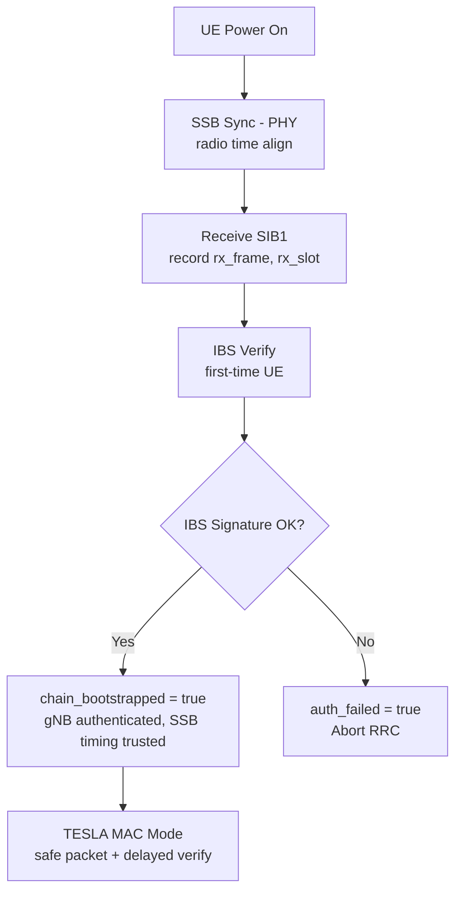

# Time Synchronization for TF5 Bootstrapping

[Back to Index](index.md)

---

This document consolidates the time-synchronization model and the TESLA "safe packet" timing check for TF5.

## References

- **RFC 4082 Section 2.2**: Time synchronization requirements for TESLA
- **3GPP TS 38.101**: UE RF conformance requirements (timing accuracy bounds)
- **3GPP TS 38.133**: UE measurement requirements (synchronization accuracy)

---

## 1. Goal and Context

TESLA requires each receiver to be loosely time-synchronized with the sender in the following sense:

- The receiver must know an **upper bound** on how far its clock can lag behind the sender’s clock, denoted here as $D$ (analogous to TESLA’s $D_t$).

In bootstrapping, we assume **downlink-only** operation prior to authentication (no uplink handshake to compute $D$). Therefore, we rely on **PHY-layer radio-time alignment** (frame/slot timing) and **offline-provisioned bounds** to obtain a conservative $D$ usable in TESLA’s safe-packet test.

---

## 2. Notation

### 2.1 Real (ideal) time

- $\tau \in \mathbb{R}$: ideal “real time” (not directly observable).

### 2.2 Clocks (radio-time clocks)

- Sender (gNB) PHY/radio clock:
  $$C_s : \mathbb{R} \to \mathbb{R},\quad \tau \mapsto C_s(\tau)$$
- Receiver (UE) PHY/radio clock:
  $$C_r : \mathbb{R} \to \mathbb{R},\quad \tau \mapsto C_r(\tau)$$

These are not wall clocks. They represent the radio time axis (frame/slot/symbol timing) each side uses internally.

### 2.3 Same-time clock skew

Define the same-real-time skew:
$$\Delta(\tau) \triangleq C_s(\tau) - C_r(\tau)$$

TESLA’s safe-packet test assumes an upper bound:
$$\forall \tau,\quad \Delta(\tau) \le D$$

Equivalently:
$$C_s(\tau) \le C_r(\tau) + D \quad \text{for all } \tau.$$

### 2.4 Propagation delay (real-time)

For a particular transmission:

- gNB transmits at real time $\tau_{tx}$
- UE receives at real time $\tau_{rx}$

Propagation delay:
$$\tau_{\text{prop}} \triangleq \tau_{rx} - \tau_{tx} > 0$$

Assume an engineering bound:
$$0 \le \tau_{\text{prop}} \le \tau_{\text{prop,max}}.$$

Important: TESLA security does not require knowing $\tau_{\text{prop}}$ at runtime; propagation and processing primarily affect availability (how many packets remain verifiable), not the correctness of the safe-packet check when $D$ is conservative.

---

## 3. What “Synchronization” Means Here

### 3.1 Event-based alignment (tx–rx) and sync error $E_{\text{sync}}$

Consider a PHY synchronization “event”:

- Sender emits a sync reference at $\tau_{\text{sync,tx}}$
- Receiver observes it at $\tau_{\text{sync,rx}} = \tau_{\text{sync,tx}} + \tau_{\text{prop,sync}}$

Synchronization accuracy is captured as:
$$C_r(\tau_{\text{sync,rx}}) = C_s(\tau_{\text{sync,tx}}) + \epsilon_{\text{sync}},\quad |\epsilon_{\text{sync}}| \le E_{\text{sync}}.$$

Equivalently:
$$|C_r(\tau_{\text{sync,rx}}) - C_s(\tau_{\text{sync,tx}})| \le E_{\text{sync}}.$$

Key point: $E_{\text{sync}}$ bounds an error between two different real-time instants ($\tau_{\text{sync,tx}}$ vs. $\tau_{\text{sync,rx}}$). It is not, by definition, a same-$\tau$ skew bound.

### 3.2 From event-based alignment to same-time skew bounds

TESLA’s safe-packet test needs a bound on $\Delta(\tau)$ at the same real time $\tau$.
We obtain such a bound by combining:

1. The post-sync alignment error $E_{\text{sync}}$
2. Clock drift bounds (ppm) over a bounded time horizon
3. A conservative implementation margin

---

## 4. CP-Based D Bound Derivation

### 4.1 OFDM Demodulation Constraint

In OFDM systems, the **Cyclic Prefix (CP)** absorbs timing errors and multipath delay spread. If the timing error exceeds the CP duration:

- **Inter-Symbol Interference (ISI)** occurs between adjacent OFDM symbols
- **Inter-Carrier Interference (ICI)** destroys OFDM subcarrier orthogonality
- → Demodulation becomes impossible

This provides a **hard physical constraint**: if the UE successfully decodes a message (SIB1, etc.), then the clock drift is automatically bounded by the CP duration.

### 4.2 CP Duration by Numerology

| SCS (kHz) | Normal CP Duration | Reference |
|-----------|-------------------|-----------|
| 15        | **4.69 μs**       | 3GPP TS 38.211 Table 5.3.1-1/2 |
| 30        | 2.34 μs           | |
| 60        | 1.17 μs           | |
| 120       | 0.59 μs           | |

Since SIB1 typically uses 15 kHz SCS, the hard limit is **4.69 μs**.

### 4.3 D Bound Derivation

At any time $\tau$ where message decoding is successful:
$$\Delta(\tau) \le \text{CP}_{\max} = 4.69 \mu s$$

Adding an implementation safety margin:
$$D = \text{CP}_{\max} + M_{\text{impl}} = 4.69 + 1000 \approx 1005 \mu s$$

Where $M_{\text{impl}} = 1000 \mu s$ absorbs:

- Residual timestamping quantization/jitter
- Software processing latency variations
- Any unmodeled system-level delays

### 4.4 Comparison with TESLA Interval

$$T_{\text{int}} = 20 \text{ ms} \gg D \approx 1 \text{ ms}$$

The TESLA interval duration is ~20× larger than D, providing substantial margin for the safe packet test.

---

## 5. Mapping TESLA Time to PHY Time (Intervals)

TESLA divides time into uniform intervals of duration $T_{\text{int}}$, starting at sender-time origin $T_0$.

Sender-side interval index at real time $\tau$:
$$I_s(\tau) \triangleq \left\lfloor \frac{C_s(\tau) - T_0}{T_{\text{int}}} \right\rfloor.$$

A packet sent in interval $i$ uses key $K_i$, disclosed after delay $d$ intervals (i.e., disclosed in interval $i+d$).

---

## 6. Receiver “Safe Packet” Timing Test (TESLA Condition)

Upon receiving a packet $P_j$ carrying interval index $i$, the receiver:

1. Records arrival time immediately (as close to PHY arrival as feasible):
   $$T \triangleq C_r(\tau_{rx,j}).$$

2. Computes an upper bound on the sender’s clock at the moment of arrival:
   $$t_j \triangleq T + D.$$

3. Computes the highest sender interval the sender could be in:
   $$x \triangleq \left\lfloor \frac{t_j - T_0}{T_{\text{int}}} \right\rfloor.$$

4. Performs the safe packet test:
   $$x < i + d.$$

If true, then at arrival time the sender could not yet have reached the disclosure interval for key $K_i$, so the packet is safe to buffer (though not yet verifiable until disclosure).
If the test fails, the receiver treats the packet as unsafe/unverified (typically drop or do not buffer for later authentication).

---

## 7. What the Sender Must “Guarantee” (and How)

To instantiate this safely, the network (system designer / PLMN / gNB vendor) provisions bounds for:

1. $E_s$ (gNB drift bound)
   - Under sender control via oscillator/clock discipline and conformance testing.

2. $E_r$ (UE drift bound)
   - Not known per-device at runtime; taken as the worst-case UE conformance bound for “honest/compliant” UEs.

3. $E_{\text{sync}}$ (sync accuracy bound)
   - Derived from PHY sync/tracking design and validated empirically.
   - Practically: define it for the class of UEs that can successfully decode the relevant broadcast channel(s) under minimum service conditions.

4. $\Delta T_{\max}$ (validity horizon)
   - A design choice: shorter $\Delta T_{\max}$ reduces $D$.

5. $M_{\text{impl}}$ (margin)
   - Chosen to absorb implementation uncertainties; commonly easiest to pick as an integer multiple of a radio-time quantum (symbol/slot).

6. (Optional) $\tau_{\text{prop,max}}$
   - Used for ultra-conservative analysis; TESLA security itself does not require runtime knowledge of propagation delay.

---

## 8. Practical Interpretation (The “20 ms” Intuition)

When we say “UE is synchronized,” we do not mean the UE receives a signal at the same real time it was transmitted (impossible). Instead:

- If the gNB transmits something aligned to its radio-time at “20 ms,”
- the UE’s radio-time clock labels the received waveform as belonging to that “20 ms” point (up to $E_{\text{sync}}$),
- while the actual physical reception occurs later in real time by $\tau_{\text{prop}}$.

TESLA’s safety check uses the UE’s recorded arrival time in its radio-time clock plus the bound $D$ to ensure the key could not have been disclosed yet.

---

## 9. Implementation Checklist (Receiver Side)

**Provisioned/configured inputs:**

- $T_0, T_{\text{int}}, d$ (TESLA schedule)
- $D$ (clock-skew bound)

**UE runtime procedure per packet:**

1. Timestamp arrival $T$ as early as possible.
2. Compute $t_j = T + D$.
3. Compute $x = \left\lfloor (t_j - T_0)/T_{\text{int}} \right\rfloor$.
4. Safe iff $x < i + d$; buffer only if safe.

**Design-time responsibilities:**

- Choose conservative $M_{\text{impl}}$ (implementation margin) to ensure $D$ is valid for the intended operating conditions.

---

## 10. Implementation

### 10.1 CLI Parameters

D is configured via CLI parameter rather than calculated at runtime.

| CLI Option | Default | Description |
|------------|---------|-------------|
| `--tesla-d-bound` | 1005 μs | Upper bound on (sender_time - receiver_time) for safe packet test |

The default value was derived using the CP-based formula (see §4):
$$D = \text{CP}_{\max} + M_{\text{impl}} = 4.69 + 1000 \approx 1005 \mu s$$

### 10.2 Initial Time Sync Verification

**Status:** Removed (implicit after IBS verification)

With the removal of `timesync_info` from the TESLA extension, explicit initial time sync verification is no longer performed. The rationale:

1. A legitimate gNB does not forge SSB timing
2. Once IBS signature verification succeeds, the gNB is confirmed legitimate
3. Therefore, the SSB-derived timing is implicitly trusted

### 10.3 Default Parameter Values

**File:** `openair3/SECU/tf5_tesla.h`

| Parameter | Default | Rationale |
|-----------|---------|-----------|
| `TF5_TESLA_DEFAULT_D_BOUND_US` | 1005 μs | CP-based derivation: CP_max (4.69 μs) + M_impl (1000 μs) |

### 10.4 Graceful Degradation

If authentication fails, the UE falls back to **signature-only mode**:
- Each SIB1 is verified via IBS signature
- TESLA MAC verification is bypassed
- This prevents availability attacks via deliberate clock manipulation

### 10.5 State Diagram



Note: Initial time sync verification is now implicit. Once the gNB is authenticated via IBS signature, its SSB timing is trusted.

### 10.6 Code References

| Function | File | Purpose |
|----------|------|---------|
| `tf5_ue_safe_packet_test()` | `openair3/SECU/tf5_tesla.c` | Safe packet test (uses D) |
| `tf5_ue_init()` | `openair3/SECU/tf5_tesla.c` | Initialize UE with D and timestamp window |
| `nr_rrc_process_sib1()` | `openair2/RRC/NR_UE/rrc_UE.c` | SIB1 processing with time sync |

### 10.7 Configuration

D is configured via command-line option:

```bash
# Using default (D=1005us)
./nr-uesoftmodem --tesla-core-mpk /path/to/mpk.bin

# Custom D value (e.g., for challenging RF environments)
./nr-uesoftmodem --tesla-core-mpk /path/to/mpk.bin \
    --tesla-d-bound 2000
```

Timestamp replay window is configured via command-line option:

```bash
# Using default window (60000ms)
./nr-uesoftmodem --tesla-core-mpk /path/to/mpk.bin

# Custom window value
./nr-uesoftmodem --tesla-core-mpk /path/to/mpk.bin \
    --signature-timestamp-window-ms 30000
```

### 10.8 Parameter Rationale

This section documents the standards-based justification for the D bound derivation.

#### CP-Based D Derivation

The D bound is derived from the **Cyclic Prefix (CP) duration** constraint in OFDM systems:

| Parameter | Value | Reference | Justification |
|-----------|-------|-----------|---------------|
| $\text{CP}_{\max}$ | 4.69 μs | 3GPP TS 38.211 Table 5.3.1-1/2 | Normal CP at 15 kHz SCS |
| $M_{\text{impl}}$ | 1000 μs | Design choice | Implementation safety margin |
| **D** | **1005 μs** | Derived | $\text{CP}_{\max} + M_{\text{impl}}$ |

#### Why CP Duration is the Hard Limit

In OFDM systems, the Cyclic Prefix absorbs timing errors and multipath delay spread. If timing error exceeds CP duration:

- **Inter-Symbol Interference (ISI)** occurs between adjacent OFDM symbols
- **Inter-Carrier Interference (ICI)** destroys OFDM subcarrier orthogonality
- → **Demodulation becomes impossible**

Therefore, if a UE successfully decodes SIB1, its clock drift is automatically bounded by the CP duration.

#### CP Duration by Numerology

| SCS (kHz) | Normal CP | Reference |
|-----------|-----------|-----------|
| 15        | **4.69 μs** | 3GPP TS 38.211 Table 5.3.1-1/2 |
| 30        | 2.34 μs   | |
| 60        | 1.17 μs   | |
| 120       | 0.59 μs   | |

Since SIB1 typically uses 15 kHz SCS, we use **4.69 μs** as the hard limit.

#### $M_{\text{impl}}$ = 1000 μs (Implementation Margin)

**Reference:** Design choice (no specific standard)

Safety margin to absorb implementation uncertainties:
- Residual timestamping quantization/jitter
- Software processing latency variations
- Any unmodeled system-level delays

1 ms is approximately 14 OFDM symbols at 15 kHz SCS. This provides reasonable safety slack without excessive delay in TESLA authentication.

#### Comparison with TESLA Interval

$$T_{\text{int}} = 20 \text{ ms} \gg D \approx 1 \text{ ms}$$

The TESLA interval duration is ~20× larger than D, ensuring the safe packet test has substantial margin.
