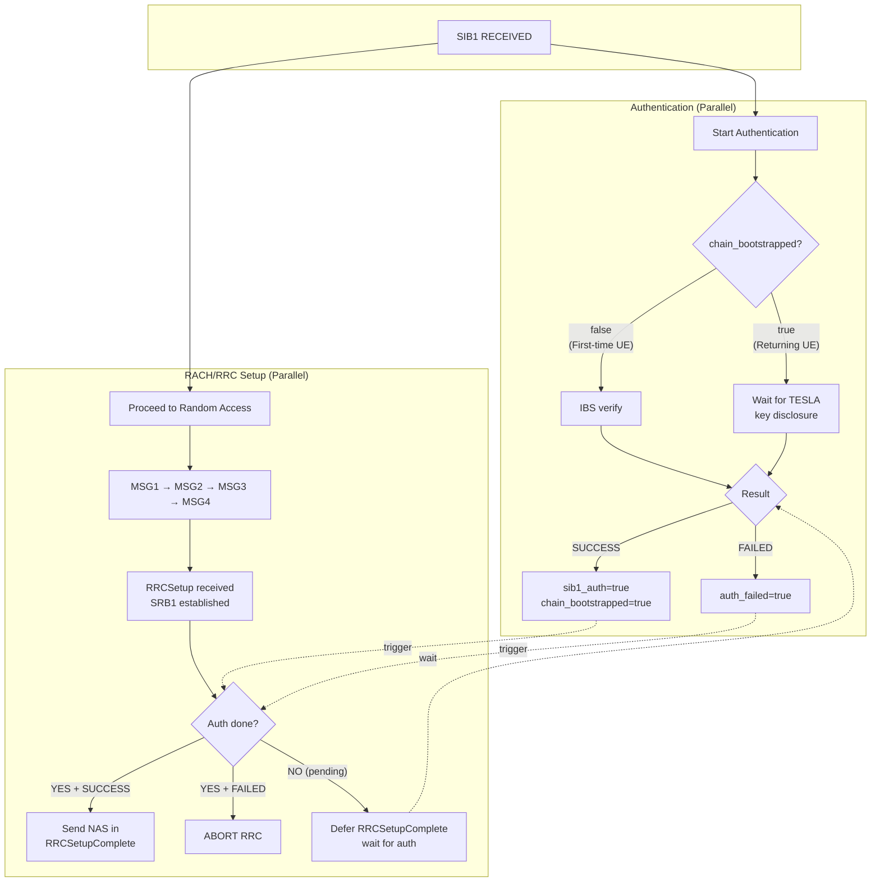

# UE-Side Implementation

[Back to Index](index.md)

---

## Initialization

**Location**: [rrc_UE.c:1651-1694](../openair2/RRC/NR_UE/rrc_UE.c#L1651-L1694)

```c
// Allocate TESLA state
SI_info->tesla_state = calloc(1, sizeof(tf5_tesla_ue_state_t));

// Load Core's Master Public Key (MPK) for IBS verification
nrUE_params_t *params = get_nrUE_params();
uint8_t mpk[96];
int rc = tf5_tesla_load_pubkey(params->tesla_core_mpk_file, mpk);
if (rc == 0) {
    tf5_tesla_ue_init(SI_info->tesla_state, mpk, slots_per_frame);
}
```

**Command-line parameter**: `--tesla-core-mpk <path>`
- Path to Core's Master Public Key (MPK) file (96 bytes)
- Generate with: `./tf5_ibs_pkg_keygen pkg_keys/msk.bin pkg_keys/mpk.bin`

**Note**: In IBS mode, UEs need only the **Core's Master Public Key (MPK)**, not individual gNB public keys. The same MPK file can verify signatures from any gNB whose key was issued by the Core PKG.

---

## Parallel Authentication with RACH/RRC

The UE performs SIB1 authentication **in parallel** with RACH/RRC setup to minimize latency while protecting sensitive information (SUCI in NAS Registration).

### Security Constraint

**NAS Registration Request (containing SUCI) MUST NOT be sent until SIB1 is authenticated.**

If authentication fails, the RRC connection is aborted before any NAS message is transmitted.

### UE Types

| UE Type | Has K_0? | Authentication Method | Timing |
|---------|----------|----------------------|--------|
| First-time | No | IBS signature | Immediate (fast) |
| Returning | Yes | TESLA MAC | Delayed (waits for key disclosure) |

### State Fields for Parallel Authentication

**Location**: [tf5_tesla.h:140-187](../openair3/SECU/tf5_tesla.h#L140-L187)

```c
typedef struct {
    // ... existing fields ...

    // Parallel authentication state
    bool     chain_bootstrapped;      // TESLA chain established via IBS (persistent)
    bool     sib1_authenticated;      // Current SIB1 verified (sig OR tesla)
    bool     auth_in_progress;        // Authentication running in parallel
    bool     auth_failed;             // Authentication failed - must abort RRC
    bool     rrcsetup_deferred;       // RRCSetupComplete deferred waiting for auth
    uint8_t  rrcsetup_transaction_id; // Saved transaction ID for deferred RRCSetupComplete
} tf5_tesla_ue_state_t;
```

---

## Parallel Authentication Flow



---

## SIB1 Processing Flow

**Location**: [rrc_UE.c:502-630](../openair2/RRC/NR_UE/rrc_UE.c#L502-L630) `nr_rrc_process_sib1()`

### First-Time UE (chain_bootstrapped == false)

```
1. Unpack TESLA extension from lateNonCriticalExtension

2. Build signature auth_input
   └── Re-encode SIB1 (without lateNonCriticalExtension)
   └── tf5_tesla_build_sig_auth_input(sib1, tesla_params, interval_index, disclosed_key)
       (tesla_params includes T_0, authenticated by signature)

3. Extract Cell ID from SIB1's cellAccessRelatedInfo
   └── tf5_extract_cell_id_from_sib1(sib1, cell_id)

4. Verify IBS signature (synchronous - fast)
   └── tf5_tesla_ibs_verify(mpk, cell_id, auth_input, signature)
   ├── SUCCESS:
   │   └── Chain bootstrapped: chain_bootstrapped = true, sib1_authenticated = true (gNB authenticated, SSB timing trusted)
   │   └── If rrcsetup_deferred: send RRCSetupComplete now
   └── FAILED:
       └── auth_failed = true
       └── nr_rrc_abort_connection() → return
```

### Returning UE (chain_bootstrapped == true)

Per RFC 4082 Section 3.5, the safe packet test MUST be performed FIRST before buffering or MAC verification.

```
1. Unpack TESLA extension from lateNonCriticalExtension

2. Safe packet test: tf5_tesla_ue_safe_packet_test()
   └── FAILED: Skip this SIB1 → return
   └── PASSED: Continue to step 3

3. Build MAC auth_input (excludes interval_index, disclosed_key, tesla_params)
   └── Re-encode SIB1 (without lateNonCriticalExtension)
   └── tf5_tesla_build_mac_auth_input(sib1, gnb_key_validity_end)
       (tesla_params authenticated via BLS signature during first-time verification)

4. Buffer current SIB1 for future TESLA verification
   └── tf5_tesla_ue_buffer_sib1()
   └── sib1_authenticated = false (until verified)

5. Check if disclosed key available for PREVIOUSLY buffered SIB1
   └── If interval matches: tf5_tesla_ue_verify_buffered()
       ├── SUCCESS:
       │   └── sib1_authenticated = true
       │   └── If rrcsetup_deferred: send RRCSetupComplete now
       └── FAILED:
           └── auth_failed = true
           └── nr_rrc_abort_connection() → return
   └── If no key yet: auth_in_progress = true (keep waiting)
```

---

## NAS Gating in RRCSetup Processing

**Location**: [rrc_UE.c:2128](../openair2/RRC/NR_UE/rrc_UE.c#L2128) `nr_rrc_process_rrcsetup()`

The RRC connection setup (bearers, cell group config) proceeds normally, but NAS message transmission is gated on authentication:

```c
if (tesla_state->auth_failed) {
    // Should not reach here normally - abort
    nr_rrc_abort_connection();
    return;
}

if (tesla_state->sib1_authenticated || tesla_state->chain_bootstrapped) {
    // Auth succeeded - include NAS in RRCSetupComplete
    rrc_ue_generate_RRCSetupComplete();
    return;
}

// Auth in progress - defer RRCSetupComplete
tesla_state->rrcsetup_deferred = true;
tesla_state->rrcsetup_transaction_id = Transaction_id;
// RRCSetupComplete will be sent when auth completes
```

---

## RRC Connection Abort

**Location**: [rrc_UE.c:2037](../openair2/RRC/NR_UE/rrc_UE.c#L2037) `nr_rrc_abort_connection()`

Called when TESLA authentication fails (signature or MAC verification):

```c
static void nr_rrc_abort_connection(NR_UE_RRC_INST_t *rrc, int gNB_index)
{
    // Stop timers (SIB1, T300, T301, T319)
    // Reset RRC state to IDLE
    // Clear RNTI
    // Reset MAC (GO_TO_IDLE cause)
    // Clear TESLA pending state
}
```

**Security**: This ensures no NAS message (containing SUCI) is ever sent if SIB1 authentication fails, protecting against fake base station attacks.

---

## Safe Packet Test

**Source**: [tf5_tesla.c:571](../openair3/SECU/tf5_tesla.c#L571) `tf5_tesla_ue_safe_packet_test()`

The safe packet test determines if a message could have been forged by an attacker who saw a key disclosure:

```c
bool tf5_tesla_ue_safe_packet_test(state, ext, rx_sfn, rx_slot) {
    // Compute current interval using rx_sfn/rx_slot (recorded at reception time)
    // and CACHED tesla parameters (authenticated during first-time UE verification via BLS signature)
    uint32_t x = compute_interval(rx_sfn, rx_slot,
                                  state->tesla_params.t0,
                                  state->tesla_params.t_int_ms);
    uint32_t i = ext->interval_index;  // claimed interval from sender
    uint8_t d = state->tesla_params.disclosure_delay;  // cached, authenticated

    // Safe if: x < i + d
    return (x < i + d);
}
```

**Note**: The safe packet test uses `state->tesla_params` (cached from first authenticated SIB1) for timing calculations, while `ext->interval_index` is the claimed interval from the sender. This ensures the UE uses authenticated parameters rather than potentially untrusted values from the current extension.

---

## Key Chain Verification (O(1) Optimization)

**Source**: [tf5_tesla.c:722](../openair3/SECU/tf5_tesla.c#L722) `tf5_tesla_ue_verify_key_chain()`

Key chain verification is called automatically by `tf5_tesla_ue_verify_buffered()` before MAC verification.
This ensures disclosed keys are cryptographically validated against a trusted anchor key.

### Anchor Key Strategy

Instead of chaining every disclosed key back to K_0 (which requires O(i) hash operations), the UE uses the **last verified key** as anchor:

1. **First SIB1 (interval i)**: BLS signature authenticates both K_0 and K_{i-d}
   - K_{i-d} becomes the anchor (0 hash ops - signature authenticated)
2. **Subsequent SIB1s**: New disclosed key verified against last anchor
   - Verify: F(K_{new}) == K_{anchor}? (typically 1 hash op)
   - Anchor updates to K_{new} after successful verification

### Example (d=1)

```
Interval i (UE joins): anchor = K_{i-1}  (signature authenticated)
Interval i+1: verify K_i → K_{i-1} (1 hash), anchor = K_i
Interval i+2: verify K_{i+1} → K_i (1 hash), anchor = K_{i+1}
...
```

### Implementation

```c
bool tf5_tesla_ue_verify_key_chain(state, disclosed_key, key_index) {
    // Require valid trust anchor (set by IBS signature or previous TESLA verification)
    // chain_bootstrapped indicates the anchor is valid
    if (!state->chain_bootstrapped) return false;

    if (key_index > state->trust_anchor_idx) {
        // Chain from disclosed key down to trust anchor
        uint32_t steps = key_index - state->trust_anchor_idx;
        // Apply F 'steps' times and compare with anchor
        // O(1) for consecutive intervals
    }
    return true;
}
```

**Security Note**: If a disclosed key does not chain to the anchor, `tf5_tesla_ue_verify_buffered()` returns error -6
and the buffered SIB1 MAC verification is rejected. This prevents use of forged keys.

---

## Key Recovery for Lost Disclosures

**Source**: [tf5_tesla.c](../openair3/SECU/tf5_tesla.c) `tf5_tesla_ue_verify_with_key_recovery()`

Per RFC 4082 Section 3.5:
> "Using a disclosed key, we can calculate all previous disclosed keys, so even if packets are lost, we will still be able to verify buffered, safe packets from earlier time intervals."

### Problem Scenario

When a SIB1 containing a key disclosure is lost, buffered SIB1s from earlier intervals cannot be verified without key recovery:

```
Interval 5: SIB1 buffered (needs K_5 for MAC verification)
Interval 6: SIB1 LOST (would have disclosed K_5)
Interval 7: SIB1 received, discloses K_6
```

Without key recovery, the SIB1 from interval 5 would never be verified.

### Recovery Algorithm

Using the one-way chain property `K_i = F(K_{i+1})`, the UE can derive missing keys:

1. Receive disclosed key K_{disclosed_interval}
2. Find all buffered intervals requiring verification
3. Derive intermediate keys: `K_{disclosed} → K_{disclosed-1} → ... → K_{earliest}`
4. Verify all buffered entries using the derived keys
5. Update anchor to disclosed_interval

### Example (d=1, Lost SIB1)

```
Interval 5: SIB1 buffered (needs K_5)
Interval 6: SIB1 LOST
Interval 7: SIB1 received, discloses K_6

Key Recovery:
  1. Verify K_6 chains to anchor (one-time check)
  2. Derive K_5 = F(K_6)
  3. Verify interval 5 entry with derived K_5
  4. Update anchor to K_6
```

### Implementation

```c
int tf5_tesla_ue_verify_with_key_recovery(state, disclosed_key, disclosed_interval, ...) {
    // Step 1: Find range of buffered intervals
    uint32_t earliest_buffered = find_earliest_buffered(state);
    uint32_t verify_start = MAX(earliest_buffered, trust_anchor_idx + 1);
    uint32_t verify_end = MIN(latest_buffered, disclosed_interval);

    // Step 2: Verify disclosed key chains to trust anchor (once)
    if (!tf5_tesla_ue_verify_key_chain(state, disclosed_key, disclosed_interval))
        return -6;  // Key chain failed

    // Step 3: Derive all keys from disclosed_interval down to verify_start
    key_cache[disclosed_interval] = disclosed_key;
    for (i = disclosed_interval - 1; i >= verify_start; i--)
        key_cache[i] = F(key_cache[i + 1]);  // tf5_tesla_chain_key()

    // Step 4: Verify all buffered entries
    for each buffered entry in [verify_start, verify_end]:
        verify_mac(entry, key_cache[entry.interval_index]);

    // Step 5: Update trust anchor
    state->trust_anchor_key = disclosed_key;
    state->trust_anchor_idx = disclosed_interval;
}
```

### Complexity

- **Time**: O(d + buffer_size) where d = gap between earliest buffered and disclosed interval
- **Space**: O(buffer_size) for key cache (stack allocated, bounded by `TF5_TESLA_BUFFER_QUEUE_SIZE`)

In practice with `d=1` and `buffer_size=4`, this is at most 5-6 key derivations per verification.

---

## Security Summary

| Scenario | SUCI Protected? | Connection Aborted? |
|----------|-----------------|---------------------|
| First-time UE, BLS succeeds | Yes | No |
| First-time UE, BLS fails | Yes | **Yes** |
| Returning UE, TESLA MAC succeeds | Yes | No |
| Returning UE, TESLA MAC fails | Yes | **Yes** |
| Attacker spoofs SIB1 | Yes | **Yes** |

**Key Property**: NAS Registration is always gated on successful authentication. RACH/RRC can proceed in parallel, but SUCI is never exposed until SIB1 is verified.
