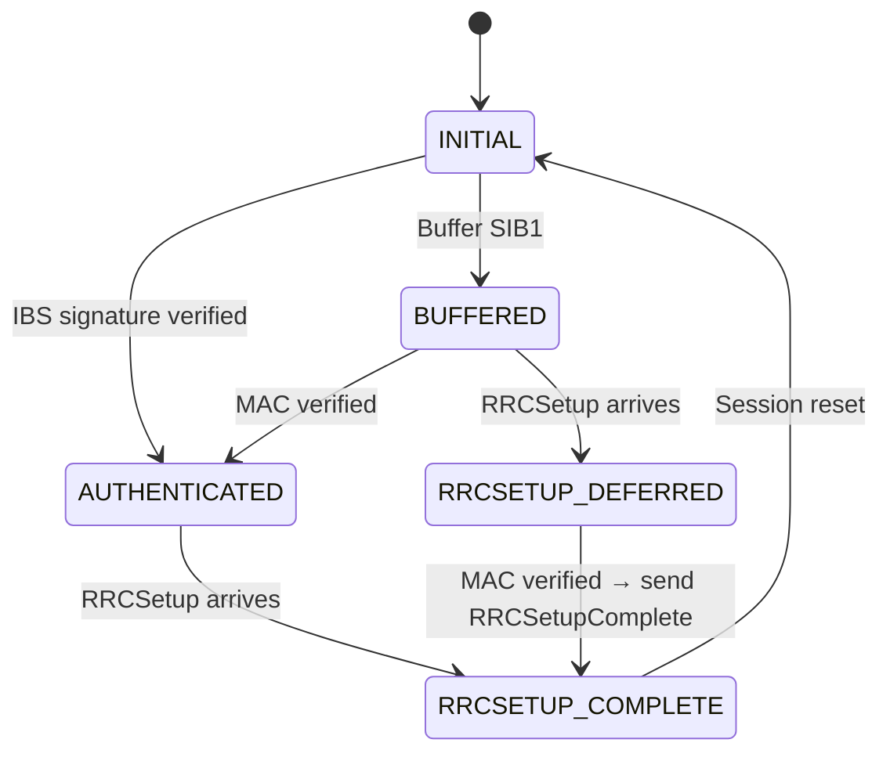
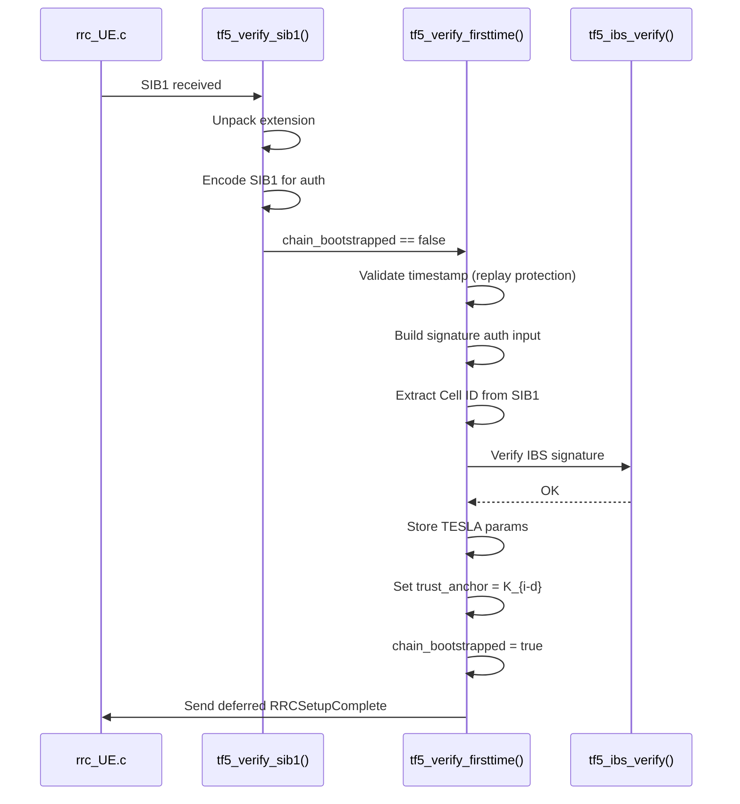
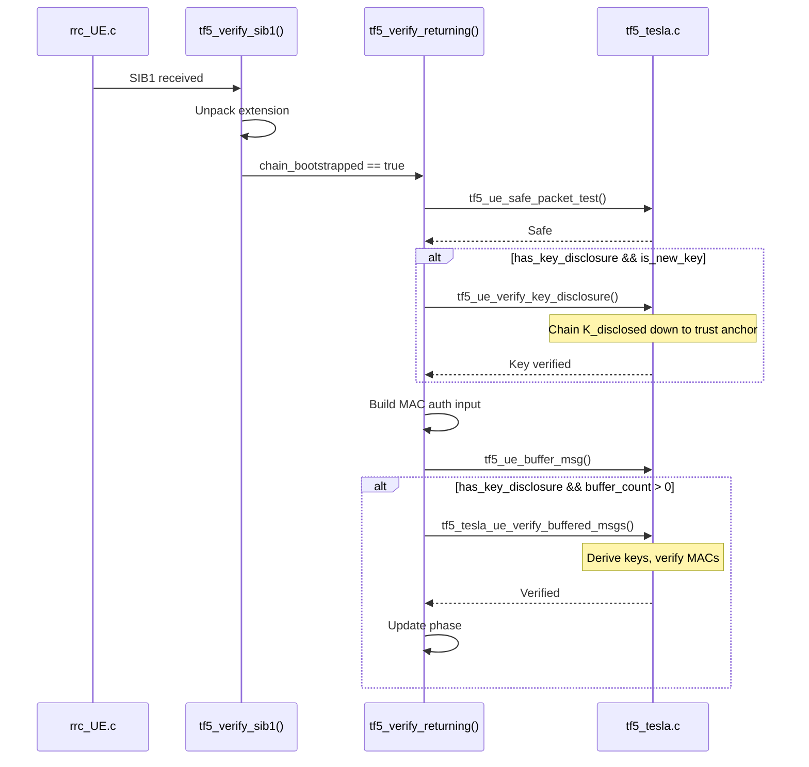

# UE Implementation

[Back to Index](index.md)

---

## Overview

The UE (User Equipment) is responsible for:

1. **First-time verification**: Validate IBS signature, establish trust anchor
2. **Returning verification**: Perform safe packet test, verify key chain, buffer and verify MACs
3. **NAS gating**: Defer RRCSetupComplete until SIB1 is authenticated

The UE uses **dual authentication**:
- **IBS Signature** (expensive, one-time): Establishes TESLA chain trust
- **TESLA MAC** (cheap, ongoing): Efficient authentication after bootstrap

---

## Source Files

| File | Purpose |
|------|---------|
| `openair2/RRC/NR_UE/rrc_UE.c` | Main verification logic, NAS gating |
| `openair2/RRC/NR_UE/rrc_defs.h` | UE state structure integration |
| `openair3/SECU/tf5_tesla.c` | Core verification functions |
| `openair3/SECU/tf5_tesla.h` | Data structures and API |

---

## Verification Entry Point

All SIB1 verification starts in `tf5_verify_sib1()` ([rrc_UE.c:760-801](../openair2/RRC/NR_UE/rrc_UE.c#L760-L801)).

### Entry Flow

```c
tf5_verify_result_t tf5_verify_sib1(rrc, SI_info, sib1, rx_frame, rx_slot)
{
    // Skip for dedicated SIB1 (RRC-protected)
    if (rx_frame < 0) return TF5_VERIFY_SKIP_DEDICATED;

    // Unpack and validate extension
    tf5_extension_t ext;
    tf5_tesla_unpack_and_validate(sib1, &ext);

    // Re-encode SIB1 for authentication
    uint8_t sib1_buf[512];
    tf5_encode_sib1_for_auth(sib1, sib1_buf, &sib1_len);

    // Branch based on chain state
    if (!state->chain_bootstrapped) {
        return tf5_verify_firsttime(...);
    } else {
        return tf5_verify_returning(...);
    }
}
```

---

## First-Time UE Verification

`tf5_verify_firsttime()` ([rrc_UE.c:605-679](../openair2/RRC/NR_UE/rrc_UE.c#L605-L679)) handles UEs that haven't yet established the TESLA chain.

### Steps

1. **Timestamp Validation** (lines 614-630)
   ```c
   uint64_t ue_time_ms = tf5_rp_get_wallclock_ms();
   int ts_rc = tf5_rp_validate_timestamp(ue_time_ms,
                                         ext->timestamp_ms,
                                         state->rp_timestamp_window_ms);
   ```
   - Validates timestamp within window (default 60 seconds)
   - Prevents replay attacks
   - Fails fast before expensive crypto

2. **Build Signature Auth Input** (lines 635-645)
   ```c
   tf5_build_sig_auth_input(sig_auth_input, &sig_auth_len,
                            sib1_buf, sib1_len,
                            ext->te_version, &ext->tesla_params,
                            ext->validity_end, ext->i,
                            ext->key_disclosure, ext->timestamp_ms);
   ```
   Signature covers: `SIB1 || version || params || validity || i || K_{i-d} || timestamp`

3. **Extract Cell ID** (lines 647-649)
   ```c
   uint8_t cell_id[TF5_IBS_CELL_ID_LEN];
   tf5_extract_cell_id_from_sib1(sib1, cell_id);
   ```
   Cell ID is the identity for IBS verification.

4. **IBS Signature Verification** (lines 651-661)
   ```c
   int sig_rc = tf5_ibs_verify(state->mpk,
                               cell_id, ext->validity_end,
                               sig_auth_input, sig_auth_len,
                               ext->signature);
   ```
   Uses pre-provisioned Core Master Public Key (MPK).

5. **Establish Trust Anchor** (lines 663-675)
   ```c
   memcpy(&state->tesla_params, &ext->tesla_params, sizeof(tf5_tesla_params_t));
   state->chain_bootstrapped = true;
   memcpy(state->trust_anchor_key, ext->key_disclosure, TF5_TESLA_KEY_LEN);
   state->trust_anchor_idx = (int32_t)ext->i - ext->tesla_params.d;
   ```
   - Stores TESLA parameters
   - Accepts disclosed key as trust anchor
   - For bootstrap intervals (i < d), `trust_anchor_idx = -1` (K_{-1})

6. **Send Deferred RRCSetupComplete** (line 677)
   ```c
   tf5_send_deferred_rrcsetupcomplete(rrc, SI_info);
   ```

---

## Returning UE Verification

`tf5_verify_returning()` ([rrc_UE.c:681-755](../openair2/RRC/NR_UE/rrc_UE.c#L681-L755)) handles UEs with an established TESLA chain.

### Steps

1. **Safe Packet Test** (lines 693-697)
   ```c
   if (!tf5_ue_safe_packet_test(ue_state, tf5_ext, rx_frame, rx_slot)) {
       return TF5_VERIFY_SKIP_UNSAFE;
   }
   ```
   Per RFC 4082: `x = floor((T + D - T_0) / T_int)` must be `< i + d`

2. **Key Disclosure Check** (lines 699-716)
   ```c
   bool has_key_disclosure = (tf5_ext->i >= ue_state->tesla_params.d);

   if (has_key_disclosure && is_new_key) {
       if (!tf5_ue_verify_key_disclosure(ue_state, ext->key_disclosure, key_disclosure_interval)) {
           return TF5_VERIFY_FAIL_KEYCHAIN;
       }
   }
   ```
   Verifies: `F(F(...F(K_disclosed))) == trust_anchor_key`

3. **Buffer SIB1** (lines 718-730)
   ```c
   tf5_build_mac_auth_input(mac_auth_input, &mac_auth_len,
                            sib1_buf, sib1_len, ext->validity_end);
   tf5_ue_buffer_msg(ue_state, mac_auth_input, mac_auth_len,
                     ext->i, ext->tesla_tag, should_trigger_rrc);
   ```
   MAC auth input: `SIB1 || validity_end`

4. **Verify Buffered Messages** (lines 732-751)
   ```c
   if (has_key_disclosure && buffer_queue_count > 0) {
       int rc = tf5_tesla_ue_verify_buffered_msgs(ue_state,
                                                  ext->key_disclosure,
                                                  key_disclosure_interval,
                                                  &rrc_trigger_verified);
       // Update phase based on verification result
   }
   ```

---

## Buffer Management

The UE maintains a buffer queue for pending SIB1 verification ([tf5_tesla.h:66-73](../openair3/SECU/tf5_tesla.h#L66-L73)):

```c
typedef struct {
    uint8_t  auth_input[TF5_MAX_AUTH_INPUT];  // 372B - MAC input data
    size_t   auth_input_len;
    uint32_t rx_interval_index;               // Interval of this SIB1
    uint8_t  tag[TF5_TESLA_TAG_LEN];          // 16B - Received TESLA tag
    bool     valid;                           // Entry validity flag
    bool     triggered_rrc_setup;             // This SIB1 triggered RRC session
} tf5_buffer_entry_t;
```

### Buffer Policy

- **Capacity**: 4 entries (`TF5_TESLA_BUFFER_QUEUE_SIZE`)
- **Eviction**: Oldest entry (lowest `rx_interval_index`)
- **Tracking**: `triggered_rrc_setup` marks the SIB1 that started RRC

---

## NAS Gating State Machine

The UE defers NAS registration until SIB1 is authenticated. Phase tracking is in `tf5_ue_phase_t` ([tf5_tesla.h:144-150](../openair3/SECU/tf5_tesla.h#L144-L150)):

```c
typedef enum {
    TF5_PHASE_INITIAL = 0,
    TF5_PHASE_AUTHENTICATED,
    TF5_PHASE_BUFFERED,
    TF5_PHASE_RRCSETUP_DEFERRED,
    TF5_PHASE_RRCSETUP_COMPLETE
} tf5_ue_phase_t;
```

### State Transitions



### RRCSetupComplete Deferral

When RRCSetup arrives before SIB1 authentication completes:

1. UE saves `rrcsetup_transaction_id`
2. Phase transitions to `RRCSETUP_DEFERRED`
3. When MAC verification succeeds:
   - Phase becomes `RRCSETUP_DEFERRED_AUTHENTICATED`
   - `tf5_send_deferred_rrcsetupcomplete()` sends saved response

---

## Verification Flow Diagrams

### First-Time UE



### Returning UE



---

## Key Chain Verification

`tf5_ue_verify_key_disclosure()` in [tf5_tesla.c](../openair3/SECU/tf5_tesla.c) verifies disclosed keys:

```
Given: K_disclosed at interval i_disc
       trust_anchor_key at interval i_anchor

Compute: num_steps = i_disc - i_anchor
         K_temp = K_disclosed
         for step in range(num_steps):
             K_temp = F(K_temp)

Verify:  K_temp == trust_anchor_key
```

**Optimization**: After verification, promote trust anchor to newly verified key for O(1) future verifications.

---

## Safe Packet Test

Per RFC 4082, the safe packet test ensures the key for interval `i` has not yet
been disclosed at reception time:

```
x = floor((T + D - T_0) / T_int)
Safe if: x < i + d
```

For the full derivation (clock skew bound D, timing model),
see [time-sync.md](time-sync.md).

---

## Related Documentation

- [Protocol Design](protocol.md) - Disclosure delay, bootstrap intervals
- [Time Synchronization](time-sync.md) - D bound calculation, safe packet test
- [Data Structures](data-structures.md) - `tf5_ue_state_t` structure
- [gNB Implementation](gnb-implementation.md) - Extension generation
