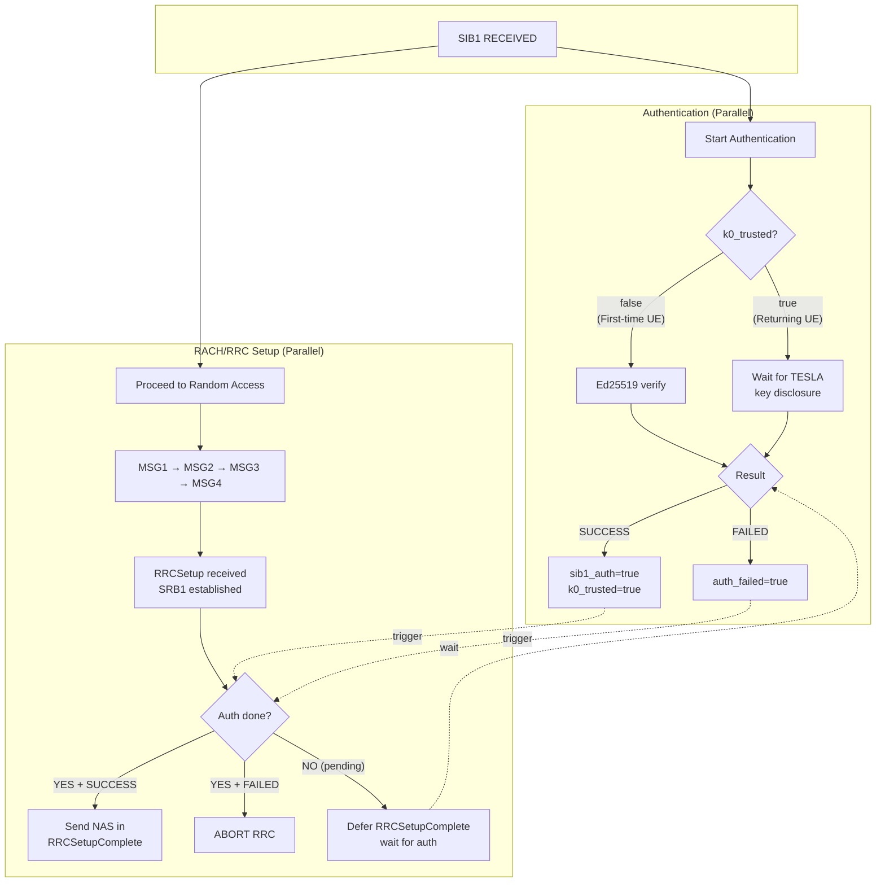

# UE-Side Implementation

[Back to Index](index.md)

---

## Initialization

**Location**: [rrc_UE.c:1475-1499](../openair2/RRC/NR_UE/rrc_UE.c#L1475-L1499)

```c
// Allocate TESLA state
SI_info->tesla_state = calloc(1, sizeof(tf5_tesla_ue_state_t));

// Load gNB public key from certificate file
nrUE_params_t *params = get_nrUE_params();
uint8_t gnb_pubkey[32];
int rc = tf5_tesla_load_cert_pubkey(params->tesla_gnb_cert_file, gnb_pubkey);
if (rc == 0) {
    tf5_tesla_ue_init(SI_info->tesla_state, gnb_pubkey, slots_per_frame);
}
```

**Command-line parameter**: `--tesla-gnb-cert <path>`
- Default: `./tesla_keys/gnb_tesla_cert.pem`
- Generate with: `./scripts/tf5_generate_cert.sh`

**Note**: The gNB certificate must be generated using `tf5_generate_cert.sh` and made available to the UE before starting. The same certificate file should be used by both gNB and UE to ensure matching public keys.

---

## Parallel Authentication with RACH/RRC

The UE performs SIB1 authentication **in parallel** with RACH/RRC setup to minimize latency while protecting sensitive information (SUCI in NAS Registration).

### Security Constraint

**NAS Registration Request (containing SUCI) MUST NOT be sent until SIB1 is authenticated.**

If authentication fails, the RRC connection is aborted before any NAS message is transmitted.

### UE Types

| UE Type | Has K_0? | Authentication Method | Timing |
|---------|----------|----------------------|--------|
| First-time | No | Ed25519 signature | Immediate (fast) |
| Returning | Yes | TESLA MAC | Delayed (waits for key disclosure) |

### State Fields for Parallel Authentication

**Location**: [tf5_tesla.h:140-187](../openair3/SECU/tf5_tesla.h#L140-L187)

```c
typedef struct {
    // ... existing fields ...

    // Parallel authentication state
    bool     k0_trusted;              // K_0 authenticated via Ed25519 (persistent)
    bool     sib1_authenticated;      // Current SIB1 verified (sig OR tesla)
    bool     auth_in_progress;        // Authentication running in parallel
    bool     auth_failed;             // Authentication failed - must abort RRC
    bool     rrcsetup_deferred;       // RRCSetupComplete deferred waiting for auth
    uint8_t  rrcsetup_transaction_id; // Saved transaction ID for deferred RRCSetupComplete
} tf5_tesla_ue_state_t;
```

---

## Parallel Authentication Flow



---

## SIB1 Processing Flow

**Location**: [rrc_UE.c:502-630](../openair2/RRC/NR_UE/rrc_UE.c#L502-L630) `nr_rrc_process_sib1()`

### First-Time UE (k0_trusted == false)

```
1. Unpack TESLA extension from lateNonCriticalExtension

2. Build signature auth_input
   └── Re-encode SIB1 (without lateNonCriticalExtension)
   └── tf5_tesla_build_sig_auth_input(sib1, static_params, timesync_info, interval_index, disclosed_key)
       (includes full content for signature verification)

3. Verify Ed25519 signature (synchronous - fast)
   └── tf5_tesla_ed25519_verify()
   ├── SUCCESS:
   │   └── Accept K_0: k0_trusted = true, sib1_authenticated = true
   │   └── If rrcsetup_deferred: send RRCSetupComplete now
   └── FAILED:
       └── auth_failed = true
       └── nr_rrc_abort_connection() → return
```

### Returning UE (k0_trusted == true)

Per RFC 4082 Section 3.5, the safe packet test MUST be performed FIRST before buffering or MAC verification.

```
1. Unpack TESLA extension from lateNonCriticalExtension

2. Safe packet test: tf5_tesla_ue_safe_packet_test()
   └── FAILED: Skip this SIB1 → return
   └── PASSED: Continue to step 3

3. Build MAC auth_input (per RFC 4082, excludes interval_index and disclosed_key)
   └── Re-encode SIB1 (without lateNonCriticalExtension)
   └── tf5_tesla_build_mac_auth_input(sib1, static_params, timesync_info)
       (excludes interval_index and disclosed_key for MAC verification)

4. Buffer current SIB1 for future TESLA verification
   └── tf5_tesla_ue_buffer_sib1()
   └── sib1_authenticated = false (until verified)

5. Check if disclosed key available for PREVIOUSLY buffered SIB1
   └── If interval matches: tf5_tesla_ue_verify_buffered()
       ├── SUCCESS:
       │   └── sib1_authenticated = true
       │   └── If rrcsetup_deferred: send RRCSetupComplete now
       └── FAILED:
           └── auth_failed = true
           └── nr_rrc_abort_connection() → return
   └── If no key yet: auth_in_progress = true (keep waiting)
```

---

## NAS Gating in RRCSetup Processing

**Location**: [rrc_UE.c:2128](../openair2/RRC/NR_UE/rrc_UE.c#L2128) `nr_rrc_process_rrcsetup()`

The RRC connection setup (bearers, cell group config) proceeds normally, but NAS message transmission is gated on authentication:

```c
if (tesla_state->auth_failed) {
    // Should not reach here normally - abort
    nr_rrc_abort_connection();
    return;
}

if (tesla_state->sib1_authenticated || tesla_state->k0_trusted) {
    // Auth succeeded - include NAS in RRCSetupComplete
    rrc_ue_generate_RRCSetupComplete();
    return;
}

// Auth in progress - defer RRCSetupComplete
tesla_state->rrcsetup_deferred = true;
tesla_state->rrcsetup_transaction_id = Transaction_id;
// RRCSetupComplete will be sent when auth completes
```

---

## RRC Connection Abort

**Location**: [rrc_UE.c:2037](../openair2/RRC/NR_UE/rrc_UE.c#L2037) `nr_rrc_abort_connection()`

Called when TESLA authentication fails (signature or MAC verification):

```c
static void nr_rrc_abort_connection(NR_UE_RRC_INST_t *rrc, int gNB_index)
{
    // Stop timers (SIB1, T300, T301, T319)
    // Reset RRC state to IDLE
    // Clear RNTI
    // Reset MAC (GO_TO_IDLE cause)
    // Clear TESLA pending state
}
```

**Security**: This ensures no NAS message (containing SUCI) is ever sent if SIB1 authentication fails, protecting against fake base station attacks.

---

## Safe Packet Test

**Source**: [tf5_tesla.c:571](../openair3/SECU/tf5_tesla.c#L571) `tf5_tesla_ue_safe_packet_test()`

The safe packet test determines if a message could have been forged by an attacker who saw a key disclosure:

```c
bool tf5_tesla_ue_safe_packet_test(state, ext, rx_sfn, rx_slot) {
    // Precondition: HFN must already be initialized (by first authenticated SIB1)
    DevAssert(state->hfn_initialized);

    // Update HFN based on SFN wraparound detection
    update_hfn(&state->current_hfn, &state->last_sfn, rx_sfn);

    // Compute current interval using CACHED static parameters
    // (authenticated during first-time UE verification via BLS signature)
    uint32_t x = compute_interval(state->current_hfn, rx_sfn, rx_slot,
                                  state->static_params.t0_*,
                                  state->static_params.t_int_ms);
    uint32_t i = ext->interval_index;  // claimed interval from sender
    uint8_t d = state->static_params.disclosure_delay;  // cached, authenticated

    // Safe if: x < i + d
    return (x < i + d);
}
```

**Note**: The safe packet test uses `state->static_params` (cached from first authenticated SIB1) for timing calculations, while `ext->interval_index` is the claimed interval from the sender. This ensures the UE uses authenticated parameters rather than potentially untrusted values from the current extension.

---

## Key Chain Verification (O(1) Optimization)

**Source**: [tf5_tesla.c:722](../openair3/SECU/tf5_tesla.c#L722) `tf5_tesla_ue_verify_key_chain()`

Key chain verification is called automatically by `tf5_tesla_ue_verify_buffered()` before MAC verification.
This ensures disclosed keys are cryptographically validated against a trusted anchor key.

### Anchor Key Strategy

Instead of chaining every disclosed key back to K_0 (which requires O(i) hash operations), the UE uses the **last verified key** as anchor:

1. **First SIB1 (interval i)**: Ed25519 signature authenticates both K_0 and K_{i-d}
   - K_{i-d} becomes the anchor (0 hash ops - signature authenticated)
2. **Subsequent SIB1s**: New disclosed key verified against last anchor
   - Verify: F(K_{new}) == K_{anchor}? (typically 1 hash op)
   - Anchor updates to K_{new} after successful verification

### Example (d=1)

```
Interval i (UE joins): anchor = K_{i-1}  (signature authenticated)
Interval i+1: verify K_i → K_{i-1} (1 hash), anchor = K_i
Interval i+2: verify K_{i+1} → K_i (1 hash), anchor = K_{i+1}
...
```

### Implementation

```c
bool tf5_tesla_ue_verify_key_chain(state, disclosed_key, key_index) {
    // Require valid anchor (set by Ed25519 or previous TESLA verification)
    if (!state->last_verified_key_valid) return false;

    if (key_index > state->last_verified_key_idx) {
        // Chain from disclosed key down to anchor
        uint32_t steps = key_index - state->last_verified_key_idx;
        // Apply F 'steps' times and compare with anchor
        // O(1) for consecutive intervals
    }
    return true;
}
```

**Security Note**: If a disclosed key does not chain to the anchor, `tf5_tesla_ue_verify_buffered()` returns error -6
and the buffered SIB1 MAC verification is rejected. This prevents use of forged keys.

---

## Security Summary

| Scenario | SUCI Protected? | Connection Aborted? |
|----------|-----------------|---------------------|
| First-time UE, Ed25519 succeeds | Yes | No |
| First-time UE, Ed25519 fails | Yes | **Yes** |
| Returning UE, TESLA MAC succeeds | Yes | No |
| Returning UE, TESLA MAC fails | Yes | **Yes** |
| Attacker spoofs SIB1 | Yes | **Yes** |

**Key Property**: NAS Registration is always gated on successful authentication. RACH/RRC can proceed in parallel, but SUCI is never exposed until SIB1 is verified.
