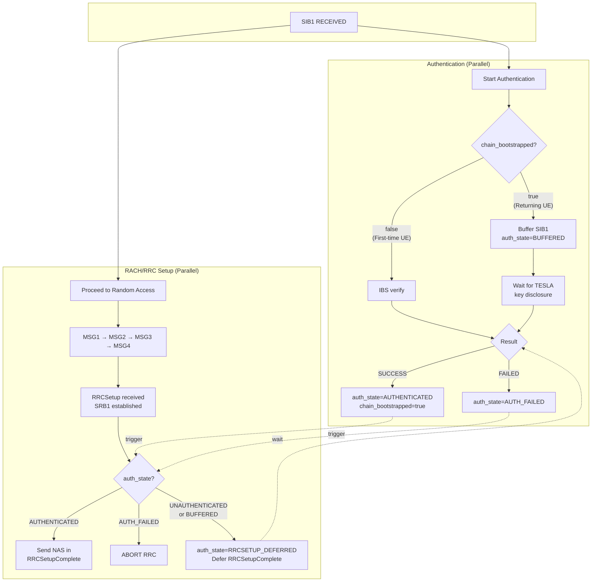

# UE-Side Implementation

[Back to Index](index.md)

---

## Initialization

**Location**: [rrc_UE.c:1691-1737](../openair2/RRC/NR_UE/rrc_UE.c#L1691-L1737)

```c
// Allocate TESLA state
SI_info->tesla_state = calloc(1, sizeof(tf5_tesla_ue_state_t));

// Load Core's Master Public Key (MPK) for IBS verification
nrUE_params_t *params = get_nrUE_params();
uint8_t mpk[96];
int rc = tf5_tesla_load_pubkey(params->tesla_core_mpk_file, mpk);
if (rc == 0) {
    tf5_tesla_ue_init(SI_info->tesla_state, mpk, slots_per_frame,
                      params->tesla_d_bound_us, params->signature_timestamp_window_ms);
}
```

**Command-line parameters**:
- `--tesla-core-mpk <path>` - Path to Core's Master Public Key (MPK) file (96 bytes)
- `--tesla-d-bound <microseconds>` - D bound for safe packet test (default: 1005)
- `--signature-timestamp-window-ms <milliseconds>` - Signature timestamp replay window (default: 60000)

Generate MPK with: `./tf5_ibs_pkg_keygen pkg_keys/msk.bin pkg_keys/mpk.bin`

**Note**: In IBS mode, UEs need only the **Core's Master Public Key (MPK)**, not individual gNB public keys. The same MPK file can verify signatures from any gNB whose key was issued by the Core PKG.

---

## Parallel Authentication with RACH/RRC

The UE performs SIB1 authentication **in parallel** with RACH/RRC setup to minimize latency while protecting sensitive information (SUCI in NAS Registration).

### Security Constraint

**NAS Registration Request (containing SUCI) MUST NOT be sent until SIB1 is authenticated.**

If authentication fails, the RRC connection is aborted before any NAS message is transmitted.

### UE Types

| UE Type | Has Trust Anchor? | Authentication Method | Timing |
|---------|-------------------|----------------------|--------|
| First-time | No | IBS signature | Immediate (fast) |
| Returning | Yes | TESLA MAC | Delayed (waits for key disclosure) |

### State Fields for Parallel Authentication

**Location**: [tf5_tesla.h:231-266](../openair3/SECU/tf5_tesla.h#L231-L266)

```c
typedef struct {
    // ... existing fields ...

    // Parallel authentication state (for NAS gating)
    bool     chain_bootstrapped;       // TESLA chain established via IBS (persistent)
    tf5_tesla_auth_state_t auth_state; // Current authentication state

    // Saved transaction ID (used when auth_state == RRCSETUP_DEFERRED)
    uint8_t  rrcsetup_transaction_id;
} tf5_tesla_ue_state_t;
```

**Authentication state enum** (see [data-structures.md](data-structures.md)):
```c
typedef enum {
    TF5_AUTH_STATE_UNAUTHENTICATED = 0,  // Initial - no SIB1 processed yet
    TF5_AUTH_STATE_BUFFERED,             // SIB1 buffered, RACH/RRC proceeding
    TF5_AUTH_STATE_RRCSETUP_DEFERRED,    // RRCSetup received while auth pending
    TF5_AUTH_STATE_AUTHENTICATED,        // SIB1 successfully authenticated
    TF5_AUTH_STATE_AUTH_FAILED           // Authentication failed - abort RRC
} tf5_tesla_auth_state_t;
```

---

## Parallel Authentication Flow



---

## SIB1 Processing Flow

**Location**: [rrc_UE.c](../openair2/RRC/NR_UE/rrc_UE.c) `nr_rrc_process_sib1()`

### TESLA Verification Entry Point

The main `nr_rrc_process_sib1()` function delegates TESLA verification to a clean dispatcher:

```c
#ifdef ENABLE_TF5
  tf5_verify_result_t tesla_rc = tf5_tesla_verify_sib1(rrc, SI_info, sib1, rx_frame, rx_slot);
  if (tesla_rc < 0) {
    tf5_tesla_on_auth_failure(rrc, SI_info, tesla_rc);
    return;
  }
#endif
```

**Note**: `gNB_index` parameter was removed from `tf5_tesla_verify_sib1()`.

### Helper Functions

| Function | Location | Purpose |
|----------|----------|---------|
| `tf5_tesla_verify_sib1()` | rrc_UE.c:796 | Main entry point with early returns |
| `tf5_tesla_unpack_and_validate()` | rrc_UE.c | Unpack extension + key expiry check |
| `tf5_tesla_encode_sib1_for_auth()` | rrc_UE.c:573 | Re-encode SIB1 without extension |
| `tf5_tesla_verify_firsttime()` | rrc_UE.c | IBS signature path (first-time UE) |
| `tf5_tesla_verify_returning()` | rrc_UE.c | TESLA MAC path (returning UE, RFC 4082) |
| `tf5_tesla_on_auth_success()` | rrc_UE.c | Send deferred RRCSetupComplete |
| `tf5_tesla_on_auth_failure()` | rrc_UE.c | Mark failed + abort RRC |
| `tf5_extract_cell_id_from_sib1()` | rrc_UE.c:499 | Extract Cell ID from SIB1 |

### Result Codes

```c
typedef enum {
    TF5_VERIFY_OK = 0,              // Verification succeeded
    TF5_VERIFY_SKIP_DEDICATED = 1,  // Dedicated delivery - skip TESLA
    TF5_VERIFY_SKIP_NO_STATE = 2,   // No tesla_state configured
    TF5_VERIFY_PENDING = 3,         // Buffered, waiting for key disclosure
    TF5_VERIFY_SKIP_UNSAFE = 4,     // Safe packet test failed

    TF5_VERIFY_FAIL_UNPACK = -1,        // Extension unpack failed
    TF5_VERIFY_FAIL_KEY_EXPIRED = -2,   // gNB key expired
    TF5_VERIFY_FAIL_ENCODE = -3,        // SIB1 re-encoding failed
    TF5_VERIFY_FAIL_NO_CLOCK = -4,      // UE wall-clock not synced
    TF5_VERIFY_FAIL_TIMESTAMP = -5,     // Timestamp validation failed
    TF5_VERIFY_FAIL_SIGNATURE = -6,     // IBS signature verification failed
    TF5_VERIFY_FAIL_MAC = -7,           // All TESLA MAC verifications failed
    TF5_VERIFY_FAIL_KEYCHAIN = -8,      // Key chain verification failed (RFC 4082 3.5 step 3)
} tf5_verify_result_t;
```

### First-Time UE (chain_bootstrapped == false)

```
1. Unpack TESLA extension from lateNonCriticalExtension

2. Build signature auth_input
   └── Re-encode SIB1 (without lateNonCriticalExtension)
   └── tf5_tesla_build_sig_auth_input(sib1, tesla_params, interval_index, disclosed_key)
       (tesla_params includes T_0, authenticated by signature)

3. Extract Cell ID from SIB1's cellAccessRelatedInfo
   └── tf5_extract_cell_id_from_sib1(sib1, cell_id)

4. Verify IBS signature (synchronous - fast)
   └── tf5_tesla_ibs_verify(mpk, cell_id, gnb_key_validity_end, auth_input, auth_len, signature)
   ├── SUCCESS:
   │   └── Chain bootstrapped: chain_bootstrapped = true
   │   └── auth_state = TF5_AUTH_STATE_AUTHENTICATED
   │   └── If rrcsetup_deferred: send RRCSetupComplete now
   └── FAILED:
       └── auth_state = TF5_AUTH_STATE_AUTH_FAILED
       └── nr_rrc_abort_connection() → return
```

### Returning UE (chain_bootstrapped == true)

Per RFC 4082 Section 3.5, the safe packet test MUST be performed FIRST before buffering or MAC verification.

```
1. Unpack TESLA extension from lateNonCriticalExtension

2. Safe packet test: tf5_tesla_ue_safe_packet_test()
   └── FAILED: Skip this SIB1 → return
   └── PASSED: Continue to step 3

3. Build MAC auth_input (excludes interval_index, disclosed_key, tesla_params)
   └── Re-encode SIB1 (without lateNonCriticalExtension)
   └── tf5_tesla_build_mac_auth_input(sib1, gnb_key_validity_end)
       (tesla_params authenticated via BLS signature during first-time verification)

4. Buffer current SIB1 for future TESLA verification
   └── tf5_tesla_ue_buffer_sib1(..., triggered_rrc_setup)
   └── auth_state = TF5_AUTH_STATE_BUFFERED (RACH/RRC proceeding)

5. Check if disclosed key available for PREVIOUSLY buffered SIB1
   └── If interval matches: tf5_tesla_ue_verify_with_key_recovery()
       ├── SUCCESS:
       │   └── auth_state = TF5_AUTH_STATE_AUTHENTICATED
       │   └── If RRCSETUP_DEFERRED: send RRCSetupComplete now
       └── FAILED:
           └── auth_state = TF5_AUTH_STATE_AUTH_FAILED
           └── nr_rrc_abort_connection() → return
```

---

## NAS Gating in RRCSetup Processing

**Location**: [rrc_UE.c:2360](../openair2/RRC/NR_UE/rrc_UE.c#L2360) `nr_rrc_process_rrcsetup()`

The RRC connection setup (bearers, cell group config) proceeds normally, but NAS message transmission is gated on authentication state:

```c
#ifdef ENABLE_TF5
if (SI_info->tesla_state) {
    switch (SI_info->tesla_state->auth_state) {
      case TF5_AUTH_STATE_UNAUTHENTICATED:
      case TF5_AUTH_STATE_BUFFERED:
        // Auth pending - defer RRCSetupComplete until verified
        LOG_I(NR_RRC, "TESLA: Auth in progress - deferring RRCSetupComplete\n");
        SI_info->tesla_state->auth_state = TF5_AUTH_STATE_RRCSETUP_DEFERRED;
        SI_info->tesla_state->rrcsetup_transaction_id = rrcSetup->rrc_TransactionIdentifier;
        return;  // Wait for auth to complete
      case TF5_AUTH_STATE_AUTHENTICATED:
        LOG_I(NR_RRC, "TESLA: SIB1 authenticated - proceeding with RRCSetupComplete\n");
        rrc_ue_generate_RRCSetupComplete(rrc, rrcSetup->rrc_TransactionIdentifier);
        return;
      default:
        DevAssert(false, "Unexpected auth state in RRCSetup processing");
    }
}
#endif
```

**State reset before verification**: Before calling `tf5_tesla_verify_sib1()`, the auth_state is reset to `TF5_AUTH_STATE_UNAUTHENTICATED` if it was previously `AUTHENTICATED` or `AUTH_FAILED` (see [rrc_UE.c:848-849](../openair2/RRC/NR_UE/rrc_UE.c#L848-L849)).

---

## RRC Connection Abort

**Location**: [rrc_UE.c:2274](../openair2/RRC/NR_UE/rrc_UE.c#L2274) `nr_rrc_abort_connection()`

Called when TESLA authentication fails (signature or MAC verification):

```c
static void nr_rrc_abort_connection(NR_UE_RRC_INST_t *rrc)
{
    // Stop timers (SIB1, T300, T301, T319)
    // Reset RRC state to IDLE
    // Clear RNTI
    // Reset MAC (GO_TO_IDLE cause)
    // Clear TESLA pending state
}
```

**Security**: This ensures no NAS message (containing SUCI) is ever sent if SIB1 authentication fails, protecting against fake base station attacks.

---

## Safe Packet Test

**Source**: [tf5_tesla.c:641](../openair3/SECU/tf5_tesla.c#L641) `tf5_tesla_ue_safe_packet_test()`

The safe packet test determines if a message could have been forged by an attacker who saw a key disclosure:

```c
bool tf5_tesla_ue_safe_packet_test(state, ext, rx_sfn, rx_slot) {
    // Compute current interval using rx_sfn/rx_slot (recorded at reception time)
    // and CACHED tesla parameters (authenticated during first-time UE verification via BLS signature)
    uint32_t x = compute_interval(rx_sfn, rx_slot,
                                  state->tesla_params.t0,
                                  state->tesla_params.t_int_ms);
    uint32_t i = ext->interval_index;  // claimed interval from sender
    uint8_t d = state->tesla_params.disclosure_delay;  // cached, authenticated

    // Safe if: x < i + d
    return (x < i + d);
}
```

**Note**: The safe packet test uses `state->tesla_params` (cached from first authenticated SIB1) for timing calculations, while `ext->interval_index` is the claimed interval from the sender. This ensures the UE uses authenticated parameters rather than potentially untrusted values from the current extension.

---

## Key Chain Verification (O(1) Optimization)

**Source**: [tf5_tesla.c:884](../openair3/SECU/tf5_tesla.c#L884) `tf5_tesla_ue_verify_key_chain()`

Key chain verification is called automatically by `tf5_tesla_ue_verify_buffered()` before MAC verification.
This ensures disclosed keys are cryptographically validated against a trusted anchor key.

### Anchor Key Strategy (RFC 4082 Compliant)

Instead of chaining every disclosed key back to K_0 (which requires O(i) hash operations), the UE uses the **last verified key** as anchor:

1. **First SIB1 (interval i)**: BLS signature authenticates both K_0 and K_{i-d}
   - K_{i-d} becomes the anchor (0 hash ops - signature authenticated)
2. **Subsequent SIB1s**: New disclosed key verified against last anchor
   - Verify: F(K_{new}) == K_{anchor}? (typically 1 hash op)
   - **Anchor always updates to K_{new} after successful key chain verification**
     (per RFC 4082 Section 3.5 - this happens regardless of whether any buffered packets were verified)

**RFC 4082 Compliance**: The anchor update occurs in `tf5_tesla_ue_verify_key_chain()` immediately after the key is verified, not in `tf5_tesla_ue_verify_with_key_recovery()`. This ensures the anchor advances even when packets are lost, preventing unnecessary hash operations on subsequent verifications.

### Example (d=1)

```
Interval i (UE joins): anchor = K_{i-1}  (signature authenticated)
Interval i+1: verify K_i → K_{i-1} (1 hash), anchor = K_i
Interval i+2: verify K_{i+1} → K_i (1 hash), anchor = K_{i+1}
...
```

### Implementation

```c
bool tf5_tesla_ue_verify_key_chain(state, disclosed_key, key_index) {
    // Require valid trust anchor (set by IBS signature or previous TESLA verification)
    // chain_bootstrapped indicates the anchor is valid
    if (!state->chain_bootstrapped) return false;

    if (key_index > state->trust_anchor_idx) {
        // Chain from disclosed key down to trust anchor
        uint32_t steps = key_index - state->trust_anchor_idx;
        // Apply F 'steps' times and compare with anchor
        // O(1) for consecutive intervals
    }
    return true;
}
```

**Security Note**: If a disclosed key does not chain to the anchor, `tf5_tesla_ue_verify_with_key_recovery()` returns error -6 (key chain failure). Per RFC 4082 Section 3.5 Step 3: *"If key verification fails, the newly arrived packet P_j should be discarded"* - the calling code in `tf5_tesla_verify_returning()` removes the just-buffered packet and returns `TF5_VERIFY_FAIL_KEYCHAIN` (-8). This prevents use of forged keys and ensures compromised packets don't remain in the buffer.

---

## Key Recovery for Lost Disclosures

**Source**: [tf5_tesla.c](../openair3/SECU/tf5_tesla.c) `tf5_tesla_ue_verify_with_key_recovery()`

Per RFC 4082 Section 3.5:
> "Using a disclosed key, we can calculate all previous disclosed keys, so even if packets are lost, we will still be able to verify buffered, safe packets from earlier time intervals."

### Problem Scenario

When a SIB1 containing a key disclosure is lost, buffered SIB1s from earlier intervals cannot be verified without key recovery:

```
Interval 5: SIB1 buffered (needs K_5 for MAC verification)
Interval 6: SIB1 LOST (would have disclosed K_5)
Interval 7: SIB1 received, discloses K_6
```

Without key recovery, the SIB1 from interval 5 would never be verified.

### Recovery Algorithm

Using the one-way chain property `K_i = F(K_{i+1})`, the UE can derive missing keys:

1. Receive disclosed key K_{disclosed_interval}
2. Verify disclosed key chains to anchor (updates anchor as side-effect per RFC 4082)
3. Find all buffered intervals requiring verification
4. Derive intermediate keys: `K_{disclosed} → K_{disclosed-1} → ... → K_{earliest}`
5. Verify all buffered entries using the derived keys

### Example (d=1, Lost SIB1)

```
Interval 5: SIB1 buffered (needs K_5)
Interval 6: SIB1 LOST
Interval 7: SIB1 received, discloses K_6

Key Recovery:
  1. Verify K_6 chains to anchor (one-time check)
  2. Derive K_5 = F(K_6)
  3. Verify interval 5 entry with derived K_5
  4. Update anchor to K_6
```

### Implementation

```c
int tf5_tesla_ue_verify_with_key_recovery(state, disclosed_key, disclosed_interval, ...) {
    // Step 1: Find range of buffered intervals
    uint32_t earliest_buffered = find_earliest_buffered(state);
    uint32_t verify_start = MAX(earliest_buffered, trust_anchor_idx + 1);
    uint32_t verify_end = MIN(latest_buffered, disclosed_interval);

    // Step 2: Verify disclosed key chains to trust anchor (once)
    // NOTE: This updates the trust anchor as a side effect per RFC 4082
    if (!tf5_tesla_ue_verify_key_chain(state, disclosed_key, disclosed_interval))
        return -6;  // Key chain failed - caller must discard newly buffered packet

    // Step 3: Derive all keys from disclosed_interval down to verify_start
    key_cache[disclosed_interval] = disclosed_key;
    for (i = disclosed_interval - 1; i >= verify_start; i--)
        key_cache[i] = F(key_cache[i + 1]);  // tf5_tesla_chain_key()

    // Step 4: Verify all buffered entries
    for each buffered entry in [verify_start, verify_end]:
        verify_mac(entry, key_cache[entry.interval_index]);

    // Trust anchor already updated in verify_key_chain()
}
```

### Complexity

- **Time**: O(d + buffer_size) where d = gap between earliest buffered and disclosed interval
- **Space**: O(buffer_size) for key cache (stack allocated, bounded by `TF5_TESLA_BUFFER_QUEUE_SIZE`)

In practice with `d=1` and `buffer_size=4`, this is at most 5-6 key derivations per verification.

---

## Buffer Entry: triggered_rrc_setup Field

Each buffer entry includes a `triggered_rrc_setup` field to track which SIB1 initiated the current RRC session:

```c
typedef struct {
    // ... other fields ...
    bool triggered_rrc_setup;    // This SIB1 triggered the current RRC session
} tf5_tesla_buffer_entry_t;
```

This enables:
- Tracking whether the RRC-initiating SIB1 was successfully authenticated
- Proper handling of deferred RRCSetupComplete when verification completes
- `rrc_trigger_verified` output from `tf5_tesla_ue_verify_with_key_recovery()`

---

## Security Summary

| Scenario | SUCI Protected? | Connection Aborted? |
|----------|-----------------|---------------------|
| First-time UE, BLS succeeds | Yes | No |
| First-time UE, BLS fails | Yes | **Yes** |
| Returning UE, TESLA MAC succeeds | Yes | No |
| Returning UE, TESLA MAC fails | Yes | **Yes** |
| Attacker spoofs SIB1 | Yes | **Yes** |

**Key Property**: NAS Registration is always gated on successful authentication. RACH/RRC can proceed in parallel, but SUCI is never exposed until SIB1 is verified.
